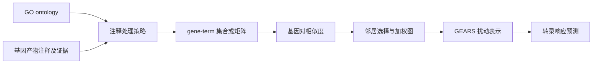

# 理解 GO：从知识表示到任务输入

本文服务于本项目的研究设计。先理解 GO 表达了什么，再决定 agent 可以补什么，最后追踪这些修改怎样进入预测模型。官方资料核对日期：2026-11-05。

## 1. 分开看待三种对象

**Ontology 本体**定义功能概念及其关系。节点是功能概念，而不是基因。例如“蛋白激酶活性”是一个活动类别，具体的蛋白质可以执行这种活动。

**Annotation 注释**将具体基因产物与功能概念联系起来，并附带证据、参考文献及来源。工程中常简写为 gene–term 关联；从蛋白质、转录本或同工型映射到 gene 时，应另外记录聚合方式。

**派生图或表示**是使用者为了计算任务构建的对象，例如 gene–term 二部图、gene–gene 相似图、embedding 或可见神经网络。它们的构造需要额外选择，不能直接当作 GO 官方本体。

一个研究对象可以形式化成：

```text
O = (T, R, E)             term 集合、关系类型和有类型的边
A = {annotation records} 注释记录及其证据
G_task = projection(O, A, policy)  任务实际消费的图
```

这一区分让我们能定位增广收益来自概念结构、注释覆盖还是图构造。

来源：[GO overview](https://geneontology.org/docs/ontology-documentation/)、[GAF 2.2](https://geneontology.org/docs/go-annotation-file-gaf-format-2.2/)。

## 2. MF、BP、CC 是三个视角

| Aspect | 回答的问题 | 例子 |
|---|---|---|
| Molecular Function（MF） | 分子层面执行什么活动？ | 催化、转运、转录调控活动 |
| Biological Process（BP） | 活动参与完成什么生物过程？ | DNA 修复、信号转导 |
| Cellular Component（CC） | 活动发生在什么细胞结构或复合体中？ | 线粒体、膜、蛋白复合体 |

MF 的类别名描述活动，而不是蛋白质实体本身。BP 中也有很宽泛的过程，不能把所有 BP 都看成有明确步骤和调控方向的 pathway。CC 不只包含位置，也包含稳定的蛋白复合体。

同一个基因产物可以同时拥有多个方面、多个粒度的注释。三个方面之间不建立跨方面的 `is_a`，较丰富的 GO 版本可以通过其他关系连接不同方面。

研究含义：相同 MF、相同 BP、相同 CC 分别提供不同的相似性；可以按方面单独构图，再评估互补性。

来源：[GO aspects](https://geneontology.org/docs/ontology-documentation/)。

## 3. 图里的边不是一种边

| 关系 | 含义 | 如何用于本项目 |
|---|---|---|
| `is_a` | A 是 B 的一种 | 保留分类关系 |
| `part_of` | A 必然作为 B 的一部分出现 | 保留组成关系 |
| `regulates` | A 对 B 的发生或表现具有调控关系 | 独立编码调控语义 |
| `positively_regulates` / `negatively_regulates` | 正／负调控 | 保留符号与方向 |
| `has_part` | 从整体描述其必然具有的部分 | 不直接用于正注释向上归并 |

边的存储方向通常是“具体 term → 更宽泛 term”或“源 → 关系目标”；GNN 的消息方向由实现另行定义。

例如，一个蛋白参与“调控某过程”，不自动推出它作为该过程本身的组成成员。`regulates` 可以用于表达相关性，但不能悄悄改写成与 `is_a` 相同的注释归并关系。

我们探索工具默认只沿 `is_a` 和 `part_of` 生成正注释的 term 集合闭包，同时保留其他类型的边用于查看。

来源：[GO relations](https://geneontology.org/docs/ontology-relations/)。

## 4. 注释传播为何影响所有下游表示

设一个基因产物直接注释到 term t。用于一般正注释归并时，将它与 t 及可沿 `is_a` / `part_of` 到达的祖先联系起来：

```text
A_direct(g) = 直接注释 term 集合
A_closure(g) = A_direct(g) ∪ allowed_ancestors(A_direct(g))
```

直接记录和派生闭包应分别保存。一个深层 term 可以有多个祖先路径，新增一条本体关系可能同时改变许多基因的闭包。

这是增广的“放大机制”：一条编辑的影响可以远大于一条 gene–term 关联。我们可以测量每次编辑影响的基因数、term 数以及最终 gene–gene 边数。

GO 的开放世界语义也很重要：没有某项注释，只表示当前记录没有确认这一关联。把未注释 pair 当负例时，应区分“未标记”与“有证据否定”。显式 `NOT` 注释必须保留否定信息；本项目探索代码只展示它，不把它并入正注释闭包。

来源：[Introduction to GO annotations](https://geneontology.org/docs/go-annotations/)。

## 5. 一条 annotation 比一个二元标签丰富

可以把一条记录理解成以下结构：

```text
subject:      带命名空间的基因／基因产物标识符
relation:     enables / involved_in / located_in / ...
object:       GO term
negation:     是否带 NOT
evidence:     证据代码
reference:    来源文献或数据库引用
with/from:    推断所依据的相关实体
taxon:        物种信息
extension:    条件、细胞、位置等补充约束
date/source:  日期和注释提供者
product_form: 特定产物形式（适用时）
```

GAF 2.2 以 17 列 TSV 保存记录。相同 subject–term pair 的多条记录可能对应不同来源或情境；构图时可合并 pair，证据表仍保留原始记录。gene symbol 适合显示，稳定数据库 ID 适合作为连接键。

来源：[GAF 2.2 specification](https://geneontology.org/docs/go-annotation-file-gaf-format-2.2/)。

## 6. Evidence code 描述证据来源

常用例子包括：`IDA`（直接测定）、`IMP`（突变表型）、`IGI`（遗传互作）、`IPI`（物理互作）、`IBA`（系统发育推断）和 `IEA`（未经逐条人工审阅的自动注释）。此外还有高通量实验、作者陈述和 curator 判断等类别。

这些代码不是统一的置信概率。采用哪组证据取决于实验目的。我们可以比较 experimental-only 与较完整的注释集合，并追踪信息来自哪里。

对 agent 生成的候选，应记录提议模型、来源段落、查证操作和验证状态；不能仅因为模型读过一篇实验论文，就给其输出直接标上人工确认的实验注释。

来源：[Guide to GO evidence codes](https://geneontology.org/docs/guide-go-evidence-codes/)。

## 7. “完整 GO”需要说明具体版本

| Edition | 内容 | 起步用途 |
|---|---|---|
| `go-basic` | 无环、排除跨 aspect 关系的版本 | 注释归并及初步探索 |
| `go` | 包含更多关系及跨 aspect 连接 | 研究更丰富的内部结构 |
| `go-plus` | 形式化公理及外部 ontology 连接 | 跨本体知识与逻辑建模 |

即使 `go-basic` 保留了 regulation 类型，也仍需明确传播策略。更丰富的 edition 不是把同一种边简单增加数量；OBO、OWL、JSON 是序列化格式，也不等同于 edition。

记录 ontology 和 annotation 的具体 release、文件头版本和 SHA256。学习时可以查看当前发布，实验时使用固定快照。旧 ID 可能成为 `alt_id` 或 obsolete；`replaced_by` 与 `consider` 要分开检查，后者不是自动替换指令。

来源：[Ontology editions](https://geneontology.org/docs/download-ontology/)、[Annotation releases](https://geneontology.org/docs/download-go-annotations/)、[GO 2026 update](https://pmc.ncbi.nlm.nih.gov/articles/PMC12807639/)。

## 8. GO 如何变成 GEARS 的输入

GEARS 利用 gene–GO term 注释集合计算基因对的 Jaccard 相似度：

```text
S(g, h) = |A(g) ∩ A(h)| / |A(g) ∪ A(h)|
```

再为各基因选择高相似度邻居，构建 perturbation similarity graph。它另外使用表达共变图；实验中要固定后者，定位 GO 修改的贡献。实际复现应核对所用代码和预处理产物中的注释集合、邻居数与方向。



由此得到三种不同的增广路径：补注释改变集合；补本体结构在重新传播时改变集合；只补文本定义则需要增加消费文本的步骤才能影响表示。后两者是否生效取决于 projection 的实现。

来源：[GEARS](https://www.nature.com/articles/s41587-023-01905-6)。

## 9. Similarity 衡量的是哪种相似

Jaccard 对集合重合进行等权计数。共同拥有一个宽泛 term，与共同拥有一个特异 term，会各贡献一次交集计数。可比较的其他设计包括：

- 对高频 term 降权，或使用信息量 `IC(t) = -log p(t)`；p(t) 必须在固定背景基因和注释策略下估计。
- 比较 term 对的共同祖先信息量，再聚合成 gene–gene 相似度。
- 使用 term 定义的文本 embedding，或对有类型的图学习表示。
- 按 BP、MF、CC 分别表示，评估不同任务所需的信息。

这些是本项目待比较的表示设计，不预设某一种更好。

值得特别观察：给两个基因补入同一 term 可以提高相似度；只给其中一个补入独有 term 反而可能降低 Jaccard。**覆盖率、相似度数值和生物学准确性是三个不同观测量。**

实验参照可以是扰动 profile、形态 profile 或独立复合体成员关系。每种参照定义一种功能相似性；关系类型不同，合理邻居也可能不同。

## 10. GO enrichment analysis 计算什么

过度富集分析（ORA）问：给定背景基因集合，在待分析基因中观察到至少这么多属于某 term 的基因，是否超出随机抽样预期？常用超几何分布或 Fisher 检验，并做多重检验校正。

背景应对应本实验能够进入候选列表的基因。若差异基因来自一批可检测基因，背景就应反映这批基因。GSEA 则使用排序列表，检验某基因集在排序中的集中情况。

本项目可固定分析算法，只替换注释集合，比较已知过程的恢复、排序及跨重复一致性。显著 term 的数量本身不代表解释质量。

来源：[GO enrichment analysis](https://geneontology.org/docs/go-enrichment-analysis/)、[GSEA 原始论文](https://doi.org/10.1073/pnas.0506580102)。

## 11. 功能相似、调控作用和干预效应的联系

两个基因参与同一过程，可能分别是激活因子、抑制因子或不同步骤的组成部分。它们具有功能联系，但敲低后的响应方向可能不同。

分类层级能支持功能归组；要表达“在某细胞中，A 的活动正向影响 B 的活动”，需要活动、方向和情境。GO-CAM 用活动实例及因果联系组织这类知识。一个相同 MF 类别可以被不同活动实例使用；活动之间的因果边不应改写为 MF 类别间的 `is_a`。

研究含义：通用功能知识可以保存在核心 GO overlay；细胞或条件相关知识可以放在带情境的活动／任务层。分别评价两层的贡献。

来源：[GO-CAM paper](https://pmc.ncbi.nlm.nih.gov/articles/PMC7012280/)。

## 12. 本项目的增广操作空间

| 操作 | 需要什么证据 | 直接影响 |
|---|---|---|
| 补 gene-product annotation | 支持功能关联的材料、物种与适用情境 | 注释矩阵与相似图 |
| 补 term–term 关系 | 定义、类型及普遍适用性 | 闭包与层级模型 |
| 提议新 term | 可区分的概念、定义及上下位定位 | 词汇覆盖与结构 |
| 补活动情境与因果联系 | 细胞、条件、方向与证据 | 情境图及干预表示 |
| 构建派生图边权或邻居 | 预先定义的关系语义、证据权重及投影规则 | 某个图消费者的表示 |

前四项补充知识，最后一项将知识转换为模型输入；实验分别记录。推荐的编辑记录包括：编辑 ID、subject、relation、object、知识类别、证据出处及段落、情境、提议模型、语义检查、版本与状态。

## 13. 任务类型怎样决定增广内容

本项目中，task-specific 指任务提出知识需求，agent 据此决定检索和整合的重点。以扰动预测为例，可以重点补充基因参与的通路、上下游调控联系和功能模块；这些内容有助于表达一次基因干预可能涉及的生物过程。具体候选由外部文献、数据库及其适用情境支撑。

任务说明描述任务类型、研究对象、细胞背景和所需知识类别。agent 完成知识整合与语义检查后，冻结增广产物，再用于下游模型。模型预测和评测指标用于测量增广的生物学价值，不回流到候选选择或编辑决策中。

```text
任务类型与生物学背景 → 知识类别与检索计划
外部文献和数据库 → 证据核对与知识整合 → 冻结的 GO 增广
冻结的 GO 增广 → 模型输入 → 下游训练与独立评测
```

通路和调控知识仍按前述语义分别存储：一般功能联系可补入 annotation／ontology，具体细胞条件下的活动联系保存在情境层，最后通过预先定义的规则形成任务模型需要的表示。

第一步动手问题见 [walkthrough](walkthrough.md)：查看一条有类型的边、计算正注释闭包、观察一次候选增广怎样改变相似度。
